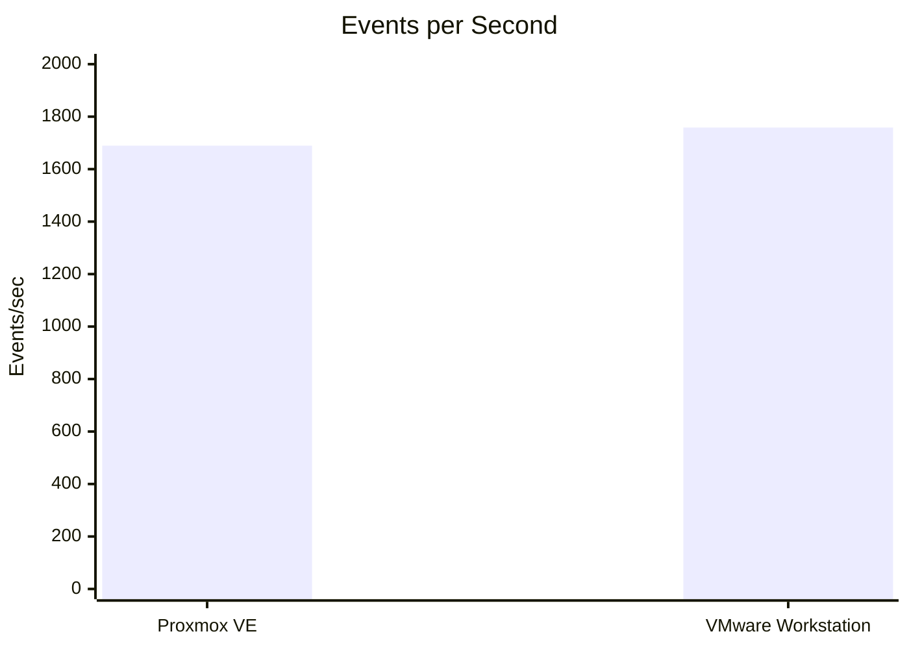
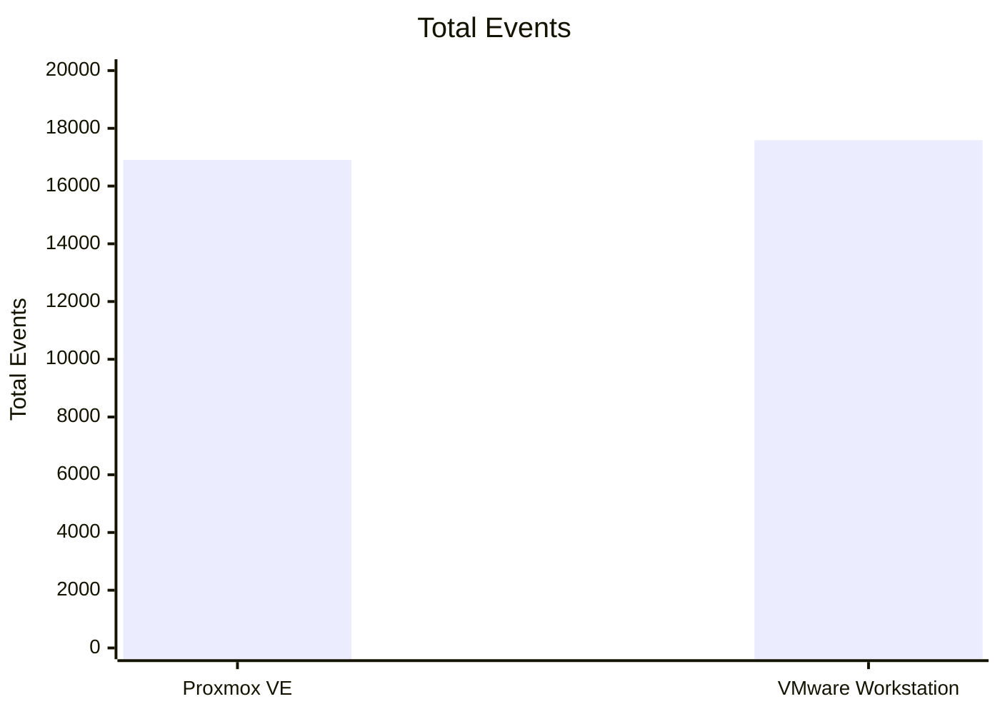
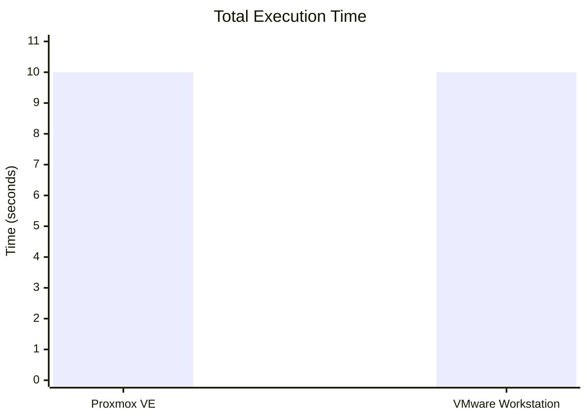

# Experiment 1 – Virtualization Performance Analysis

### Type-1 Hypervisor: Proxmox VE | Type-2 Hypervisor: VMware Workstation

## Objective

This experiment aims to study and compare the performance of virtual machines running on two different hypervisor architectures: a **Type-1 hypervisor** and a **Type-2 hypervisor**. The CPU performance of both environments is evaluated using the **Sysbench** benchmarking tool.

---

# 1. Overview

Virtualization allows multiple operating systems to run on the same physical hardware by using a hypervisor. In this lab, two different approaches to virtualization were tested and compared:

* **Type-1 Hypervisor:** Proxmox VE
* **Type-2 Hypervisor:** VMware Workstation

An Ubuntu virtual machine was created and configured on both virtualization platforms. The system was verified using Linux commands, and the CPU workload was measured using Sysbench to evaluate performance.

The experiment is organized into three main parts:

1. **Type-1 Hypervisor – Proxmox VE**
2. **Type-2 Hypervisor – VMware Workstation**
3. **Performance Comparison and Analysis**

---

# 2. Hypervisor Architecture

## 2.1 Type-1 Hypervisor – Proxmox VE

Proxmox VE is an open-source **Type-1 (bare-metal) hypervisor**. It runs directly on physical server hardware and provides the environment needed to create and manage virtual machines efficiently.

```text
Physical Hardware
        │
        ▼
┌───────────────────────┐
│      Proxmox VE       │
│    Type-1 Hypervisor  │
└───────────┬───────────┘
            │
            ▼
┌───────────────────────┐
│      Ubuntu VM        │
│                       │
│  2 vCPU               │
│  2 GB RAM             │
│  20 GB Disk           │
└───────────────────────┘
```

A detailed explanation of the Proxmox VE setup, installation steps, system verification, and benchmark process is provided in the separate **Type-1 Hypervisor – Proxmox VE** README.

---

## 2.2 Type-2 Hypervisor – VMware Workstation

VMware Workstation is a **Type-2 (hosted) hypervisor**. It runs on top of an existing host operating system and offers a convenient platform for creating and managing virtual machines.

```text
Physical Hardware
        │
        ▼
┌───────────────────────┐
│   Host Operating      │
│       System          │
└───────────┬───────────┘
            │
            ▼
┌───────────────────────┐
│  VMware Workstation   │
│    Type-2 Hypervisor  │
└───────────┬───────────┘
            │
            ▼
┌───────────────────────┐
│      Ubuntu VM        │
│                       │
│  2 vCPU               │
│  8 GB RAM             │
│  20 GB Disk           │
└───────────────────────┘
```

The detailed VMware Workstation setup, installation process, verification steps, and benchmark procedure are available in the separate **Type-2 Hypervisor – VMware Workstation** README.

---

# 3. Tools and Technologies

| Tool / Technology      | Purpose                            |
| ---------------------- | ---------------------------------- |
| **Proxmox VE**         | Type-1 virtualization              |
| **VMware Workstation** | Type-2 virtualization              |
| **Ubuntu**             | Guest operating system             |
| **Sysbench**           | CPU performance benchmarking       |
| **Linux Terminal**     | System verification and monitoring |

---

# 4. Virtual Machine Configuration

The configuration used for both virtual machines is summarized in the table below.

| Parameter         | Type-1 – Proxmox VE | Type-2 – VMware Workstation |
| ----------------- | ------------------- | --------------------------- |
| Hypervisor        | Proxmox VE          | VMware Workstation          |
| Hypervisor Type   | Type-1              | Type-2                      |
| Guest OS          | Ubuntu 22.04        | Ubuntu 64-bit               |
| CPU               | 2 vCPU              | 2 vCPU                      |
| CPU Configuration | 1 Socket, 2 Cores   | 1 Processor, 2 Cores        |
| Memory            | 2 GB                | 8 GB                        |
| Disk              | 20 GB               | 20 GB                       |
| Network           | vmbr0 / VirtIO      | NAT                         |
| Benchmark         | Sysbench CPU        | Sysbench CPU                |

### Configuration Note

Both virtual machines were configured with **2 vCPUs and 20 GB of disk space**. However, the memory allocation was different:

* Proxmox VE: **2 GB RAM**
* VMware Workstation: **8 GB RAM**

Because of this difference, the measured results reflect the performance of each specific experimental setup rather than a fully identical system configuration.

---

# 5. Linux System Verification

The Ubuntu virtual machines were checked using the following Linux commands to confirm the system was configured correctly and to monitor resource usage.

| Command       | Purpose                                            |
| ------------- | -------------------------------------------------- |
| `hostnamectl` | Displays hostname and operating-system information |
| `lscpu`       | Displays CPU and processor information             |
| `free -h`     | Displays memory usage                              |
| `df -h`       | Displays disk usage                                |
| `top`         | Monitors CPU, memory, and running processes        |

### Commands

```bash
hostnamectl
lscpu
free -h
df -h
top
```

---

# 6. Sysbench CPU Benchmark

Sysbench was used to measure the CPU performance of both virtual machines.

## 6.1 Installation

```bash
sudo apt update
sudo apt install sysbench -y
sysbench --version
```

## 6.2 Benchmark Command

The same CPU benchmark was executed in both environments:

```bash
sysbench cpu --cpu-max-prime=20000 run
```

Using the same benchmark workload provides a fair basis for comparing the results from the two hypervisors.

---

# 7. Type-1 Hypervisor Results – Proxmox VE

The results below were obtained from the Ubuntu VM running on Proxmox VE.

| Parameter            |        Result |
| -------------------- | ------------: |
| Hypervisor           |    Proxmox VE |
| Hypervisor Type      |        Type-1 |
| Guest OS             |        Ubuntu |
| CPU                  |        2 vCPU |
| Memory               |          2 GB |
| Disk                 |         20 GB |
| Total Execution Time | **10.0006 s** |
| Total Events         |    **16,903** |
| Events per Second    |  **1,689.43** |
| Minimum Latency      |   **0.57 ms** |
| Average Latency      |   **0.59 ms** |
| Maximum Latency      |   **1.09 ms** |

---

# 8. Type-2 Hypervisor Results – VMware Workstation

The results below were obtained from the Ubuntu VM running on VMware Workstation.

| Parameter            |             Result |
| -------------------- | -----------------: |
| Hypervisor           | VMware Workstation |
| Hypervisor Type      |             Type-2 |
| Guest OS             |             Ubuntu |
| CPU                  |             2 vCPU |
| Memory               |               8 GB |
| Disk                 |              20 GB |
| Total Execution Time |      **10.0003 s** |
| Total Events         |         **17,588** |
| Events per Second    |       **1,758.60** |
| Minimum Latency      |        **0.55 ms** |
| Average Latency      |        **0.57 ms** |
| Maximum Latency      |        **1.11 ms** |

---

# 9. Overall Benchmark Results

A comparison of the Sysbench results for both virtualization platforms is shown below.

| Metric               | Proxmox VE | VMware Workstation |
| -------------------- | ---------: | -----------------: |
| Total Execution Time |  10.0006 s |          10.0003 s |
| Total Events         |     16,903 |             17,588 |
| Events per Second    |   1,689.43 |           1,758.60 |
| Minimum Latency      |    0.57 ms |            0.55 ms |
| Average Latency      |    0.59 ms |            0.57 ms |
| Maximum Latency      |    1.09 ms |            1.11 ms |

---

# 10. Graphical Performance Analysis

## 10.1 Events per Second

The graph below compares the CPU benchmark throughput of the two virtual machines.



### Observation

* **Proxmox VE:** 1,689.43 events/sec
* **VMware Workstation:** 1,758.60 events/sec

## 10.2 Total Events

The graph below compares the total number of benchmark events completed by each virtual machine.



### Observation

* **Proxmox VE:** 16,903 events
* **VMware Workstation:** 17,588 events

## 10.3 Total Execution Time

The graph below compares the overall execution time for the CPU benchmark in both environments.



### Observation

* **Proxmox VE:** 10.0006 seconds
* **VMware Workstation:** 10.0003 seconds

The execution times were very close, with a difference of approximately **0.0003 seconds**.

## 10.4 Latency Comparison

The graph below compares the minimum, average, and maximum latency values recorded by Proxmox VE and VMware Workstation.

```mermaid
xychart-beta
    title "Latency Comparison"
    x-axis ["Minimum", "Average", "Maximum"]
    y-axis "Latency (ms)" 0 --> 1.2
    bar [0.57, 0.59, 1.09]
    bar [0.55, 0.57, 1.11]
```



**Legend:** 🔵 **Proxmox VE**     🟢 **VMware Workstation**

### Observation

* **Proxmox VE:** Minimum = 0.57 ms, Average = 0.59 ms, Maximum = 1.09 ms
* **VMware Workstation:** Minimum = 0.55 ms, Average = 0.57 ms, Maximum = 1.11 ms

# 11. Performance Difference

The difference in measured events per second is:

```text
1758.60 - 1689.43
= 69.17 events/sec
```

The percentage difference relative to the Proxmox VE result is:

```text
(1758.60 - 1689.43) / 1689.43 × 100
≈ 4.09%
```

Based on this benchmark, the VMware Workstation configuration recorded approximately **4.09% more events per second** than the Proxmox VE configuration.

This figure represents the observed result for these specific VM settings and should not be treated as a general statement about all Type-1 and Type-2 hypervisors.

---

# 12. Analysis of Results

## 12.1 CPU Throughput

The VMware Workstation VM recorded **1,758.60 events/sec**, whereas the Proxmox VE VM recorded **1,689.43 events/sec**.

The measured difference was **69.17 events/sec**, which is approximately **4.09%** higher than the Proxmox VE result.

---

## 12.2 Execution Time

The two environments completed the benchmark in nearly the same amount of time:

* Proxmox VE: **10.0006 s**
* VMware Workstation: **10.0003 s**

This indicates that both configurations handled the same CPU workload with only a very small difference in total runtime.

---

## 12.3 Latency

The average latency was:

* Proxmox VE: **0.59 ms**
* VMware Workstation: **0.57 ms**

The maximum latency was:

* Proxmox VE: **1.09 ms**
* VMware Workstation: **1.11 ms**

The measured latency values were very close across both systems.

---

# 13. Conclusion

This experiment provided practical experience in **virtualization, hypervisor architecture, virtual machine configuration, system monitoring, and performance benchmarking**.

A Type-1 environment was implemented using **Proxmox VE**, while a Type-2 environment was implemented using **VMware Workstation**. Ubuntu virtual machines were configured on both platforms and tested using the same Sysbench CPU benchmark.

The measured results showed:

* Proxmox VE: **1,689.43 events/sec**
* VMware Workstation: **1,758.60 events/sec**
* Proxmox VE execution time: **10.0006 s**
* VMware Workstation execution time: **10.0003 s**
* Proxmox VE average latency: **0.59 ms**
* VMware Workstation average latency: **0.57 ms**

For the configurations used in this experiment, the VMware Workstation VM recorded a higher throughput value. However, since the memory allocation and runtime environment were not identical, the results should be interpreted as a measurement of this specific experimental setup.

The experiment successfully demonstrated how **Type-1 and Type-2 hypervisors can be configured, monitored, and evaluated using a common CPU benchmarking workload**.

---

# 14. Related Experiment Documentation

The detailed setup and procedure for each environment are documented separately:

* **Type-1 Hypervisor – Proxmox VE**

  * VM creation
  * Ubuntu installation
  * Resource configuration
  * Linux system verification
  * Sysbench installation
  * CPU benchmark execution

* **Type-2 Hypervisor – VMware Workstation**

  * VM creation
  * Ubuntu installation
  * Resource configuration
  * Linux system verification
  * Sysbench installation
  * CPU benchmark execution

The current README acts as the **main experiment document**, bringing together the overall methodology, benchmark results, graphical analysis, comparison, and conclusion.
